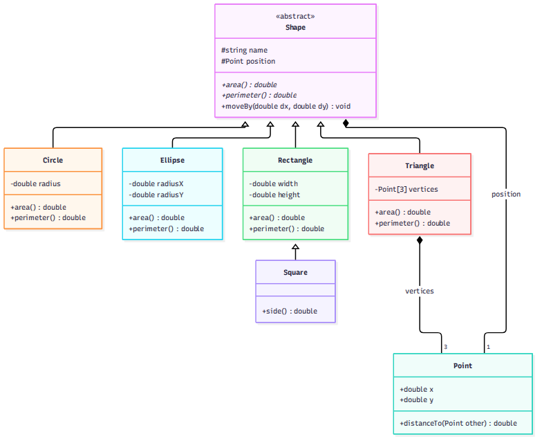
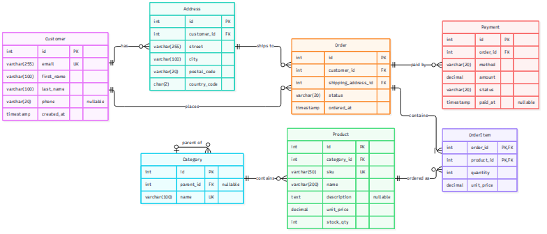
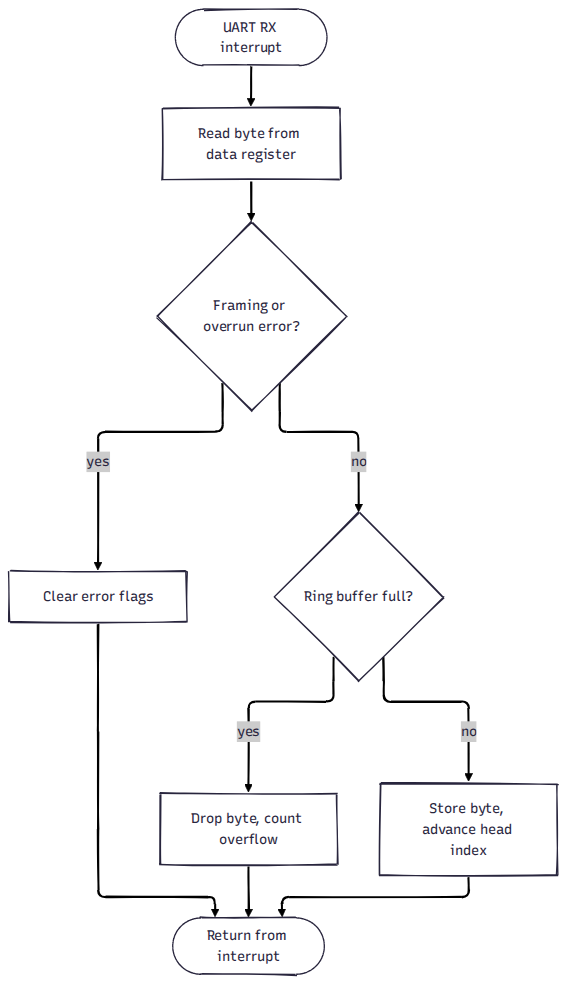
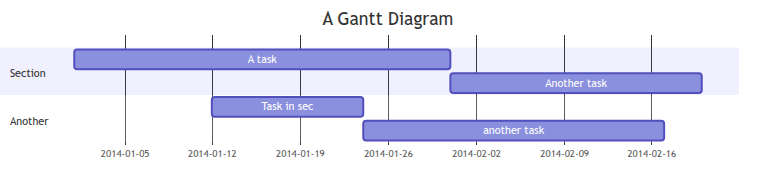
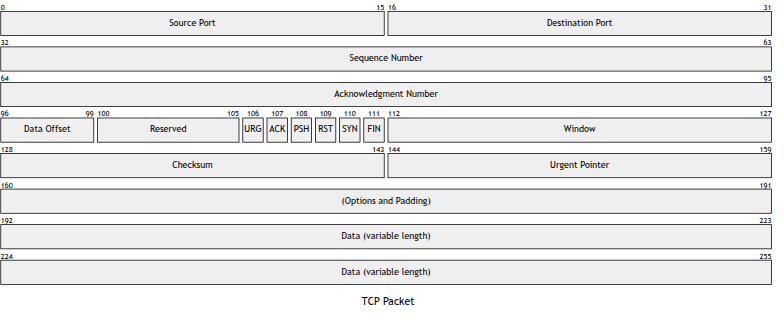
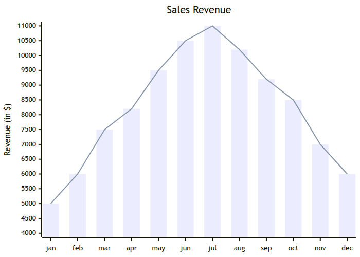

---
puppeteer: {format: A4, scale: 0.85, printBackground: true, margin: {top: 23mm, bottom: 15mm, left: 20mm, right: 20mm}, displayHeaderFooter: true, headerTemplate: '
2026-10-17
', footerTemplate: '
/
'}
---  
  
  
  
  
# Mermaid Diagrams
  
**References**:
  
- [About Mermaid ](https://mermaid.ai/open-source/intro/ )
  
## Examples
  
### Class Diagram
  

  
  
### Entity Relationship
  

  
  
### Flowchart
  

  
  
### Gantt Diagram
  

  
  
### TCP Packet
  

  
  
### XY Chart
  

  
  