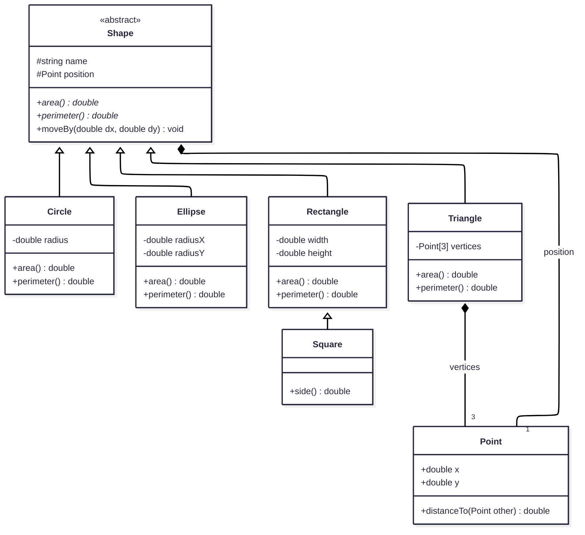
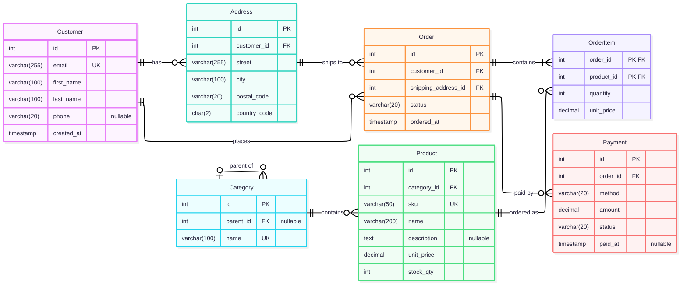
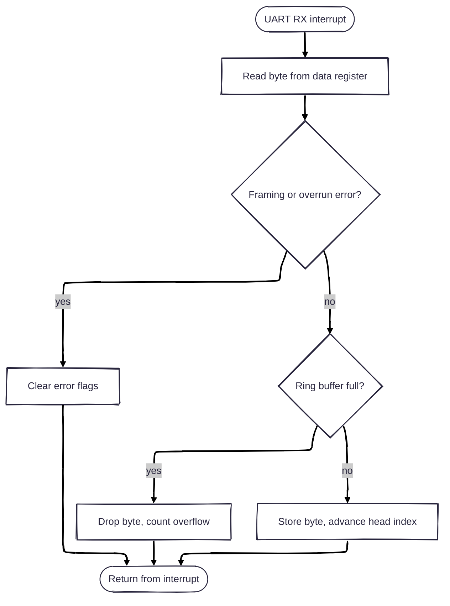
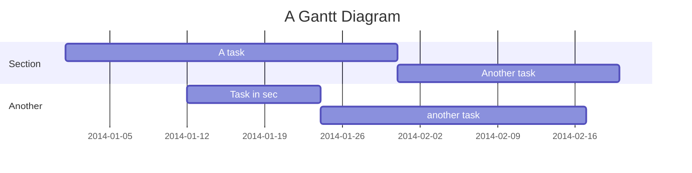
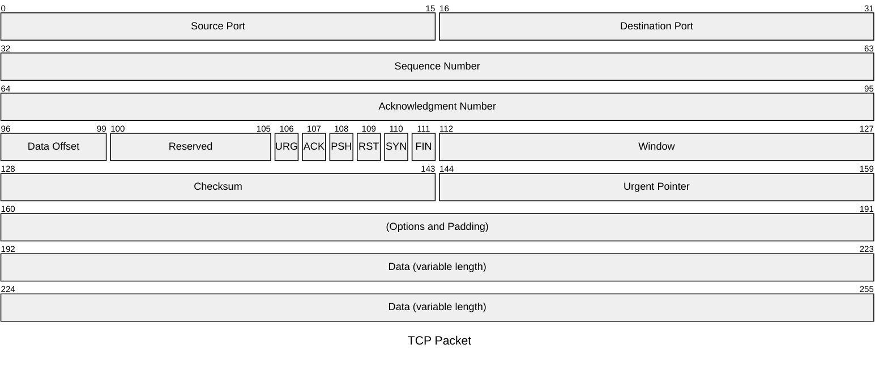
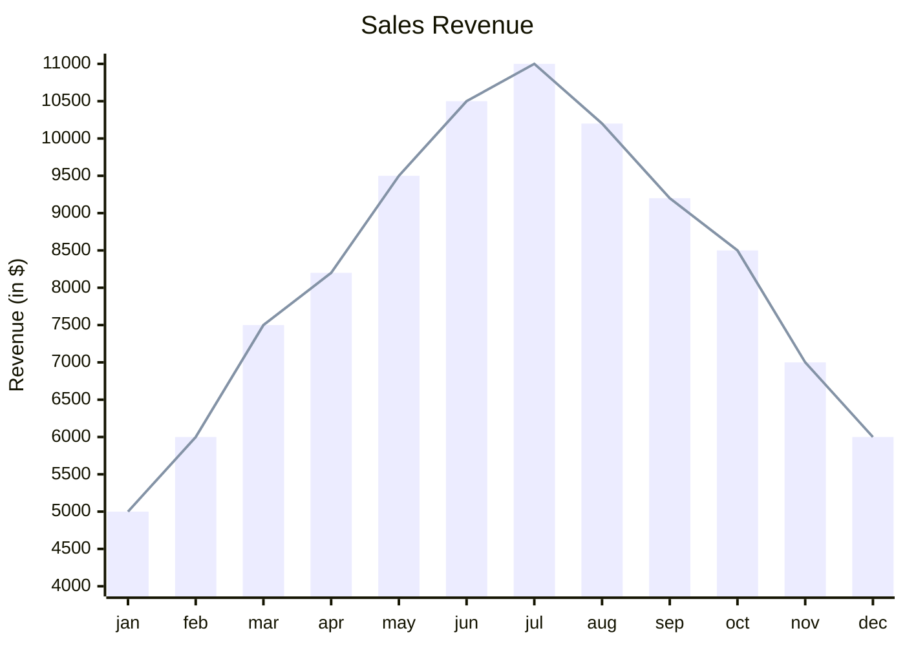

---
markdown:
  image_dir: img/mermaid
  path: test-mermaid.gfm.md
  ignore_from_front_matter: true
---

# Mermaid Diagrams

**References**:

- [About Mermaid ](https://mermaid.ai/open-source/intro/)

## Examples

### Class Diagram

### Entity Relationship

### Flowchart

### Gantt Diagram

### TCP Packet

### XY Chart

