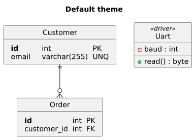
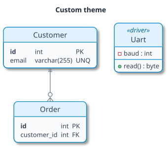
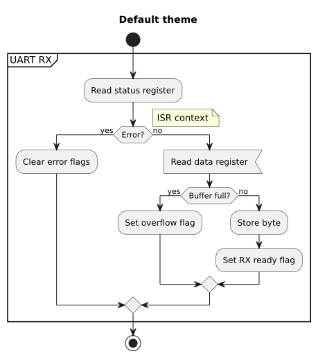
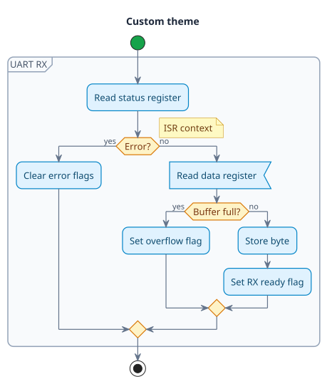
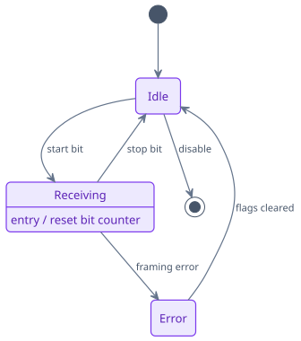
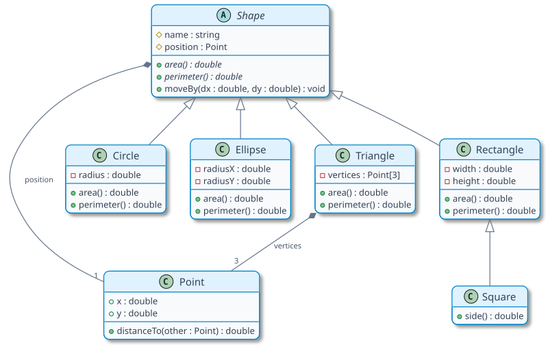
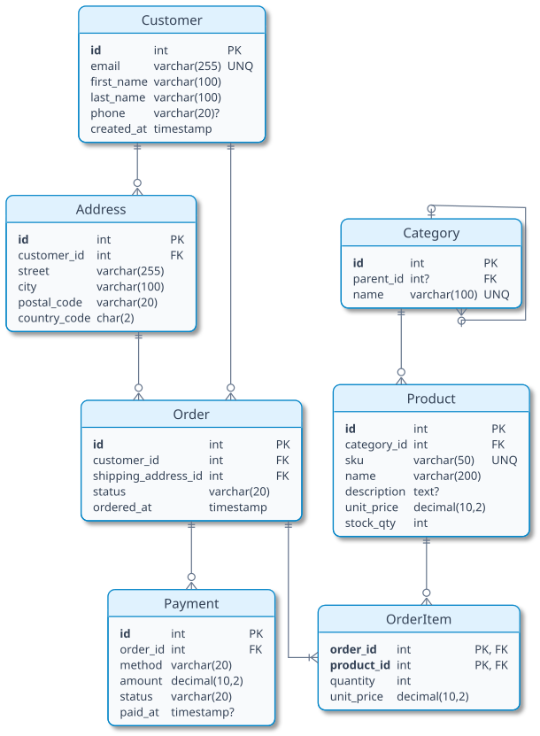
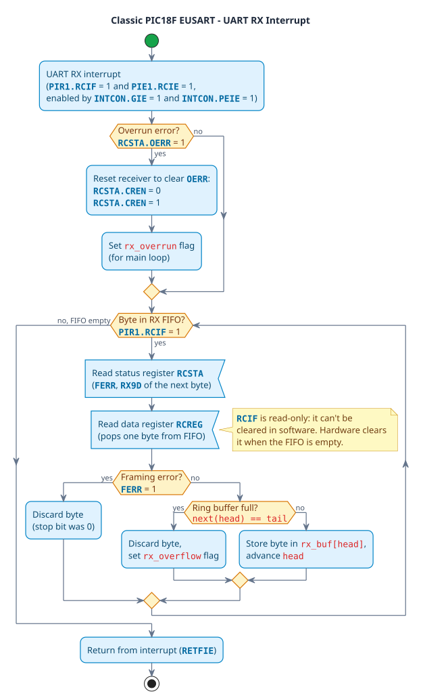
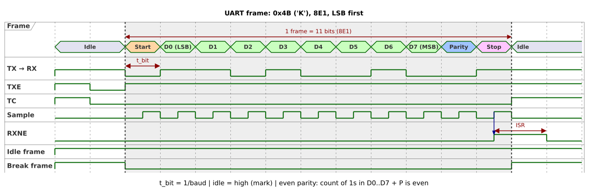

---
puppeteer: {format: A4, scale: 0.85, printBackground: true, margin: {top: 23mm, bottom: 15mm, left: 20mm, right: 20mm}, displayHeaderFooter: true, headerTemplate: '<div style="width:100%;font-size:3mm;border-bottom:1pt solid black;margin:8mm 20mm 0;display:flex;justify-content:space-between;"><span class="title"></span><span>2026-10-17</span></div>', footerTemplate: '<div style="width:100%;font-size:3mm;text-align:center;"><span class="pageNumber"></span>/<span class="totalPages"></span></div>'}
---  
  
  
  
  
# PlantUML Diagrams
  
**References**:
  
- [PlantUML](https://plantuml.com/ )
  
> [!IMPORTANT]
>
> ##### Requirements
>
> MPE renders PlantUML locally, so these must be installed:
>
> - **PlantUML** – the `plantuml.jar` file
> - **Java** – runtime used to run the jar (e.g. OpenJDK 21)
> - **GraphViz** – required for most diagram types except sequence diagrams
>
> **GraphViz** provides a program called **dot** which is expected to be found in PATH
>
> - You can also specify the environment variable `GRAPHVIZ_DOT` to set its location:\
>    `export GRAPHVIZ_DOT=/usr/bin/dot`
>
> **VS Code Settings**
>
> Then set the jar path in VS Code `settings.json`:
>
> ```json
> "markdown-preview-enhanced.plantumlJarPath": "/usr/share/java/plantuml.jar"
> ```
  
## Custom Style
  
PlantUML diagrams can be styled in three ways, from simplest to most flexible:
  
1. **Built-in themes**: one line, complete look
2. **Skinparams**: individual colors, fonts, borders, and connectors
3. **Inline overrides**: color of a single element or connector
  
They can be combined: a theme first, then skinparams to override parts of it, then inline colors for single elements.
  
### Built-in Themes
  
Add `!theme <name>` as the first line of the diagram:
  
```puml {code_block=true}
!theme sunlust
```
  
- **Light**: `plain`, `mono`, `sunlust`, `vibrant` (default)
- **Colorful**: `cerulean`, `cerulean-outline`, `cyborg`, `cyborg-outline`, `materia`, `materia-outline`, `spacelab`
- **Special**: `sketchy`, `sketchy-outline`, `blueprint`, `crt-green`, `crt-amber`
  
> [!TIP]
> To list all themes available in your PlantUML version, render a diagram containing only `help themes`.
  
### Skinparam Syntax
  
#### Direct Parameters
  
Each `skinparam` line sets one parameter. The name is `<Element><Property>`:
  
```puml {code_block=true}
skinparam BackgroundColor transparent
skinparam defaultFontName "Noto Sans"
skinparam defaultFontSize 13
skinparam classFontSize 15
skinparam classBorderColor #0284c7
skinparam activityDiamondBackgroundColor #fef3c7
```
  
- `default*` parameters apply to all elements unless overridden.
- Names are **case-insensitive**.
- Colors can be hex `#0284c7`, names `LightBlue`, or `transparent`.
  
#### Grouped Parameters
  
Parameters with the same element prefix can be grouped into a block. These two are equal:
  
```puml {code_block=true}
skinparam classBackgroundColor #f8fafc
skinparam classBorderColor #0284c7
skinparam class {
  BackgroundColor #f8fafc
  BorderColor #0284c7
}
```
  
A block without a prefix holds global parameters:
  
```puml {code_block=true}
skinparam {
  BackgroundColor transparent
  Shadowing false
  RoundCorner 10
}
```
  
### Parameter Reference
  
> [!TIP]
> To list all supported skinparams, render a diagram containing only `skinparameters`.
  
#### Global
  
| Parameter             | Description                                                      | Example       |
| --------------------- | ---------------------------------------------------------------- | ------------- |
| `BackgroundColor`     | Diagram background                                               | `transparent` |
| `DefaultFontName`     | Font of all text                                                 | `"Noto Sans"` |
| `DefaultFontSize`     | Size of all text                                                 | `13`          |
| `DefaultFontColor`    | Color of all text                                                | `#1e293b`     |
| `Shadowing`           | Drop shadows                                                     | `false`       |
| `RoundCorner`         | Corner radius of boxes                                           | `10`          |
| `Linetype`            | Connector routing: `ortho` (right angles), `polyline` (straight) | `ortho`       |
| `Nodesep` / `Ranksep` | Horizontal / vertical spacing between elements (px)              | `60`          |
| `Padding`             | Inner padding of elements                                        | `4`           |
| `Monochrome`          | Black and white only                                             | `true`        |
| `Handwritten`         | Sketchy hand-drawn look                                          | `true`        |
  
#### Connectors
  
Apply to arrows in all diagram types:
  
| Parameter                                            | Description              |
| ---------------------------------------------------- | ------------------------ |
| `ArrowColor`                                         | Line and arrowhead color |
| `ArrowThickness`                                     | Line width               |
| `ArrowFontColor` / `ArrowFontSize` / `ArrowFontName` | Arrow label text         |
  
#### Class and ER Diagrams
  
ER `entity` boxes use the same `class` parameters.
  
| Parameter (`skinparam class { ... }`)                            | Description                                                   |
| ---------------------------------------------------------------- | ------------------------------------------------------------- |
| `BackgroundColor`                                                | Box body                                                      |
| `HeaderBackgroundColor`                                          | Title area                                                    |
| `BorderColor` / `BorderThickness`                                | Outline                                                       |
| `FontColor` / `FontSize` / `FontName` / `FontStyle`              | Title text                                                    |
| `AttributeFontColor` / `AttributeFontSize` / `AttributeFontName` | Attributes and methods                                        |
| `StereotypeFontColor` / `StereotypeFontSize`                     | `<<stereotype>>` text                                         |
| `AttributeIconSize`                                              | Visibility icons (`+ - # ~`); `0` shows plain symbols instead |
  
Other useful settings:
  
| Setting                               | Description                                                              |
| ------------------------------------- | ------------------------------------------------------------------------ |
| `hide circle`                         | Hides the `C` / `E` / `A` letter icon in the header                      |
| `hide empty members`                  | Hides empty attribute/method sections                                    |
| `skinparam MinClassWidth 120`         | Minimum box width for a uniform look                                     |
| `skinparam package { ... }`           | Package/namespace frames (`BackgroundColor`, `BorderColor`, `FontColor`) |
  
#### Flowcharts (Activity)
  
| Parameter (`skinparam activity { ... }`)              | Description                      |
| ----------------------------------------------------- | -------------------------------- |
| `BackgroundColor` / `BorderColor` / `BorderThickness` | Action boxes                     |
| `FontColor` / `FontSize` / `FontName`                 | Action text                      |
| `DiamondBackgroundColor` / `DiamondBorderColor`       | `if` / `while` decision diamonds |
| `DiamondFontColor` / `DiamondFontSize`                | Decision text                    |
| `StartColor`                                          | `start` circle                   |
| `BarColor`                                            | `fork` / `end fork` bars         |
  
Decision diamonds have no padding of their own, so their text nearly touches the border. The global `skinparam Padding 4` adds space inside them (and slightly enlarges other boxes too). `skinparam ConditionEndStyle diamond` draws a merge diamond where `if` branches join.
  
Related blocks:
  
| Block                         | Description                                                                         |
| ----------------------------- | ----------------------------------------------------------------------------------- |
| `skinparam partition { ... }` | `partition` frames (`BackgroundColor`, `BorderColor`, `FontColor`)                  |
| `skinparam swimlane { ... }`  | Swimlanes (`BorderColor`, `TitleFontColor`, `Width`)                                |
| `skinparam note { ... }`      | Notes (`BackgroundColor`, `BorderColor`, `FontColor`); applies to all diagram types |
  
#### State Diagrams
  
| Parameter (`skinparam state { ... }`)                 | Description                            |
| ----------------------------------------------------- | -------------------------------------- |
| `BackgroundColor` / `BorderColor` / `BorderThickness` | State boxes                            |
| `FontColor` / `FontSize` / `FontName`                 | State name                             |
| `AttributeFontColor` / `AttributeFontSize`            | Description lines (e.g. `entry / ...`) |
  
`hide empty description` removes the empty lower section from states without description.
  
> [!TIP]
> Some parts have no `skinparam`, for example the `stop` circle in flowcharts and the `[*]` circles in state diagrams. Use the newer `<style>` syntax for those:
>
> ```puml {code_block=true}
> <style>
> stateDiagram {
>   circle { BackgroundColor #16a34a; LineColor #16a34a }
> }
> </style>
> ```
  
### Inline Overrides
  
Color a single element or connector directly in the diagram code:
  
```puml {code_block=true}
entity "Order" as o #fef9c3 ##[bold]ca8a04 { ... }
#fecaca:Critical step;
state Error #fecaca
customer ||-[#dc2626,dashed]-o{ order
A -[#16a34a,bold]-> B
```
  
| Syntax                  | Description                                         |
| ----------------------- | --------------------------------------------------- |
| `#color` after the name | Background color                                    |
| `##[style]color`        | Border style (`bold`, `dashed`, `dotted`) and color |
| `-[#color,style]->`     | Connector color and style                           |
  
### Shared Style File
  
To reuse a style across all diagrams, save the skinparams in a file (e.g. `my-style.iuml`) and include it at the top of each diagram:
  
```puml {code_block=true}
!include plantuml/my-style.iuml
class Car
Driver - Car : drives >
```
  
- Relative paths are resolved from the folder of the markdown file. MPE passes it to PlantUML as `-Dplantuml.include.path`.
- Absolute paths work too: `!include /home/user/plantuml/my-style.iuml`.
  
### Style Examples
  
#### Class and ER Diagram
  
<div class="flex">
  
  

  
  

  
  
</div>
  
#### Flowchart
  
<div class="flex">
  
  

  
  

  
  
</div>
  
#### State Diagram
  

  
  
## Examples
  
### Class Diagram
  

  
  
### Entity Relationship
  

  
  
### Flowchart
  

  
  
### Timing Diagram
  

  
  